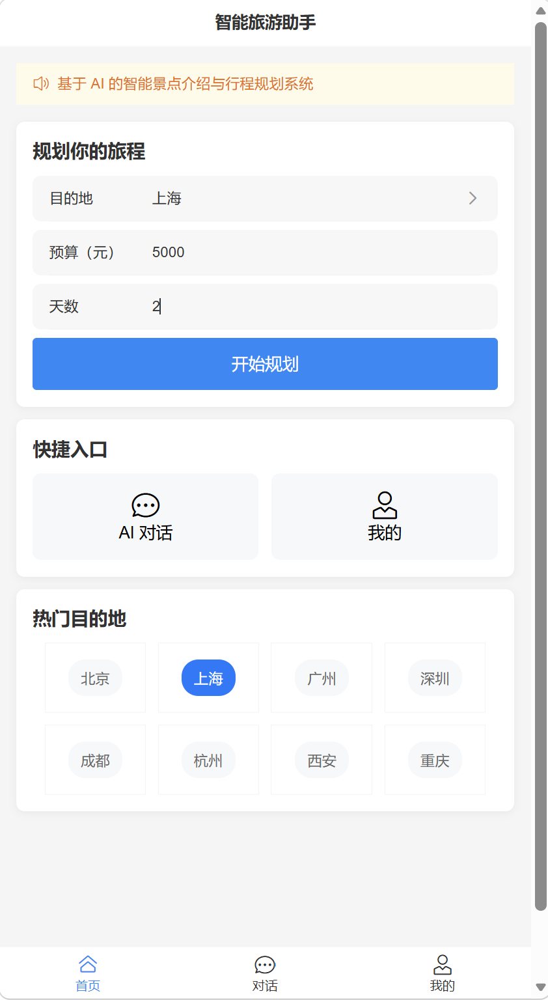
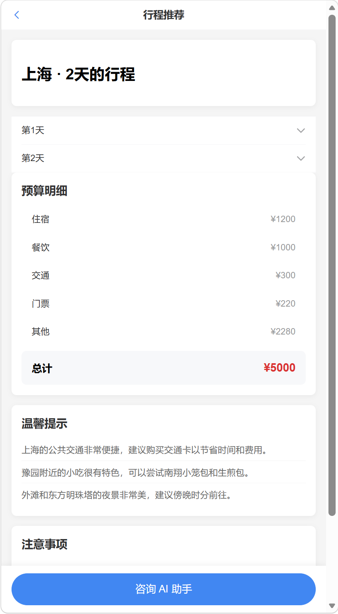
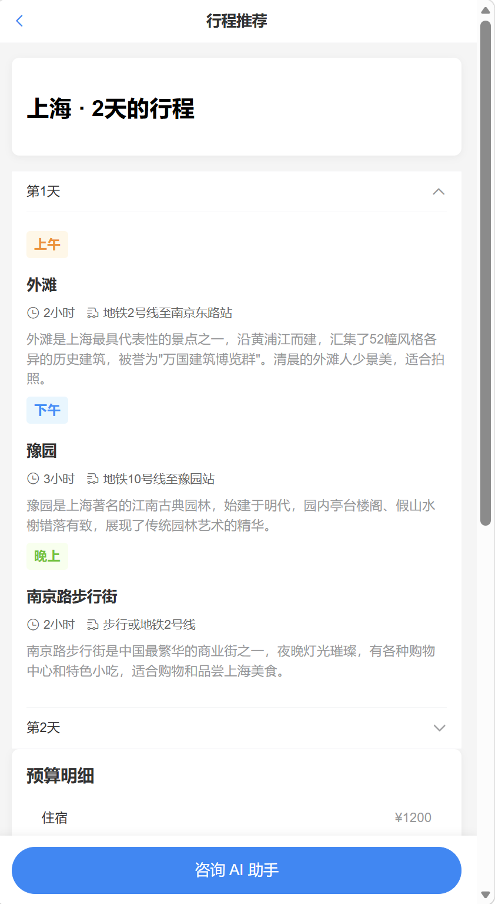
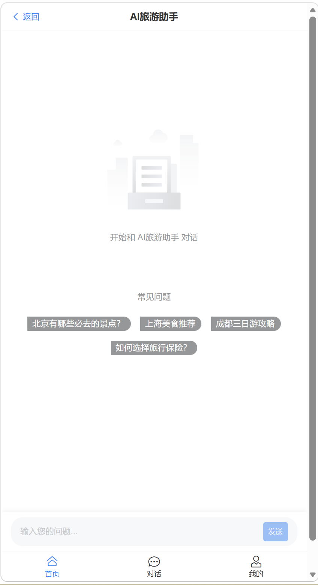
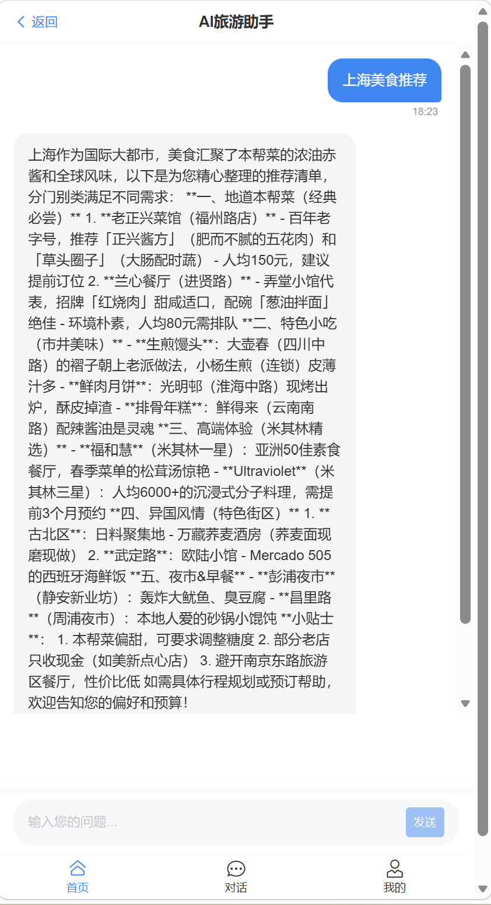
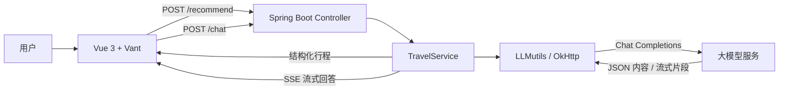

# 智能旅游助手 · AI Travel Planner

> 输入目的地、预算和旅行天数，让 AI 将旅行想法整理为每日行程，并通过流式问答提供旅行建议。

**Vue 3 · Vant 4 · Spring Boot · Java 17 · 大模型接口 · SSE**

## 项目介绍

智能旅游助手是一个面向移动端的前后端分离项目，围绕出行准备中的两个需求展开：**根据时间和预算生成旅行计划，以及随时咨询旅游问题**。

项目将大模型生成的内容转换为结构化行程，通过每日安排、景点卡片和预算明细展示；问答模块采用流式输出，让用户在回答生成过程中逐步阅读内容。适合用于展示 Vue 页面开发、Java 后端接口设计、大模型接入与流式通信能力。

## 项目预览

以 **上海 · 2 天 · 5000 元预算** 为例，展示从需求输入到行程与预算结果的主要流程。以下为实际页面截图，行程与费用是 AI 生成的建议，不代表实时路线或实际报价。

<table>
  <tr>
    <th width="33%">① 填写旅行需求</th>
    <th width="33%">② 查看每日行程</th>
    <th width="33%">③ 查看预算明细</th>
  </tr>
  <tr>
    <td valign="top"><a href="docs/images/home.png"></a></td>
    <td valign="top"><a href="docs/images/itinerary.png"></a></td>
    <td valign="top"><a href="docs/images/budget.png"></a></td>
  </tr>
  <tr>
    <td>选择目的地、预算与旅行天数，一键发起行程规划。</td>
    <td>按上午、下午、晚上组织景点，展示游览时长、交通建议与景点介绍。</td>
    <td>展示分项预算和总额，并提供温馨提示与 AI 咨询入口。</td>
  </tr>
</table>

### AI 旅游问答

从对话初始页输入旅游问题，查看 AI 返回的建议。以下以「上海美食推荐」为例，展示提问前与收到回答后的页面状态。

<table>
  <tr>
    <th width="50%">④ 开始旅游咨询</th>
    <th width="50%">⑤ 查看 AI 回答</th>
  </tr>
  <tr>
    <td align="center" valign="top"><a href="docs/images/chat-empty.png"></a></td>
    <td align="center" valign="top"><a href="docs/images/chat-response.png"></a></td>
  </tr>
  <tr>
    <td>展示常见问题示例，用户可在底部输入框输入旅游问题并发送。</td>
    <td>以聊天气泡展示用户问题和 AI 建议；回答通过流式接口逐步接收。</td>
  </tr>
</table>

点击截图可查看原图。截图保留当前页面的真实显示效果，回答中的 Markdown 标记暂以纯文本呈现；流式输出过程需通过实际操作观察，实现说明见下方「技术亮点」。

## 核心功能

| 模块 | 当前实现 |
| --- | --- |
| 旅行需求输入 | 城市选择、热门目的地快捷选择、预算及旅行天数输入 |
| AI 行程规划 | 根据目的地、预算和天数请求大模型生成旅行方案 |
| 每日行程展示 | 按天折叠展示上午、下午、晚上的景点或活动 |
| 景点信息 | 展示景点介绍、游览时长、门票及交通建议 |
| 预算明细 | 展示住宿、餐饮、交通、门票及其他费用 |
| 出行提示 | 展示模型生成的温馨提示与注意事项 |
| AI 旅游问答 | 发送旅游问题，逐步接收并展示回答内容 |
| 基础交互 | 表单校验、加载提示、聊天气泡及请求失败提示 |

### 页面导航

| 页面 | 路由 | 展示内容 |
| --- | --- | --- |
| 首页 | `/` | 旅行需求表单、热门目的地、快捷入口 |
| 行程推荐 | `/detail` | 每日安排、预算明细、旅行提示 |
| AI 对话 | `/chat` | 问题输入、流式回复、消息列表 |
| 我的 | `/profile` | 预留页面，目前仅有标题占位 |

## 技术亮点

### 1. 将模型回答转为可展示的业务数据

后端根据城市、预算、天数构造提示词，约定 `dailyItinerary`、`budgetBreakdown`、`tips` 等 JSON 字段。收到模型回答后，提取 JSON 并映射到 `TravelRecommendVO`，由前端组件负责展示。

解析逻辑兼容 Markdown 代码块及正文中的 JSON 对象；提取或解析失败时返回错误信息。这个过程展示了从自然语言生成到业务页面渲染的完整数据链路。

### 2. 打通大模型到浏览器的流式输出

后端使用 OkHttp 读取模型的流式响应，通过 Spring MVC 的 `SseEmitter` 向浏览器发送内容片段、完成标记和错误信息。前端使用 `fetch`、`ReadableStream` 与 `TextDecoder` 读取 POST 请求的响应流，将内容持续追加到聊天气泡中。

### 3. 前后端职责与组件拆分

后端按 Controller、Service、DTO、VO 分层，集中处理接口入口、业务编排和数据结构；前端将景点、预算和聊天消息拆为 `SpotItem`、`BudgetTable`、`ChatBubble` 组件，并封装普通 HTTP 请求与流式请求。

### 4. 围绕移动端组织交互

使用 Vant 的城市选择器、底部导航、折叠面板、输入框和加载组件，串联“填写需求 → 生成行程 → 查看详情 → 咨询助手”的操作流程。

## 系统架构



开发环境通过 Vite 将 `/api` 请求代理到 `http://127.0.0.1:8080`。当前项目不依赖数据库，聊天消息保存在页面内存中。

## 技术栈

版本依据当前项目配置文件整理。

| 层次 | 技术 |
| --- | --- |
| 前端框架 | Vue `^3.5.42`、Vue Router `^4.3.0` |
| UI 组件 | Vant `^4.10.2` |
| 构建工具 | Vite `^8.3.0` |
| HTTP 与流式读取 | Axios `^1.20.0`、Fetch API、ReadableStream |
| 后端框架 | Spring Boot `4.1.1`、Spring MVC |
| 开发语言 | JavaScript、Java 17 |
| 模型请求 | OkHttp `4.12.0`、Chat Completions 接口 |
| 数据处理 | Jackson、Jakarta Validation、Lombok |
| 后端构建 | Maven Wrapper |

## 项目结构

```text
TRAVEL/
├── README.md
├── trval-h5/                       # Vue 移动端前端（目录名沿用项目原名）
│   ├── src/
│   │   ├── views/                  # 首页、行程详情、对话、个人页
│   │   ├── components/             # 景点、预算、聊天气泡组件
│   │   ├── router/                 # 页面路由
│   │   └── utils/request.js        # Axios 与流式请求处理
│   ├── package.json
│   └── vite.config.js              # 路径别名与开发代理
└── travel-java/                    # Spring Boot 后端
    ├── src/main/java/com/example/traveljava/
    │   ├── controller/             # REST 与 SSE 接口
    │   ├── service/                # 提示词、行程解析、流式编排
    │   ├── utils/                  # 大模型调用
    │   ├── dto/                    # 入参与校验约束
    │   ├── vo/                     # 普通响应、行程与流事件结构
    │   └── common/                 # 校验异常处理与跨域配置
    ├── src/main/resources/application.yml
    └── pom.xml
```

## 本地运行

### 环境准备

- JDK 17，配置 `JAVA_HOME`。
- Node.js：满足本地 Vite 声明的 `^20.19.0 || >=22.12.0`，以及 npm。
- 可用的大模型 API Key、接口地址和模型名称。
- 首次安装需能访问 npm、Maven 仓库及所选模型服务。

### 1. 配置并启动后端

后端读取 `llm.api-key`、`llm.base-url`、`llm.model` 三项配置。`base-url` 应为接口基础路径，代码会自动追加 `/chat/completions`。

以下为 Windows PowerShell 示例，在项目根目录执行；替换占位值后启动：

```powershell
cd travel-java
$env:LLM_API_KEY = "替换为你的 API Key"
$env:LLM_BASE_URL = "https://api.siliconflow.cn/v1"
$env:LLM_MODEL = "替换为账号可用的模型名称"
.\mvnw.cmd spring-boot:run
```

环境变量覆盖 `application.yml` 中的同名配置。公开仓库前，请移除配置文件中的实际密钥，使用环境变量注入；若密钥已经公开，应在服务商处轮换。

macOS / Linux 可在设置对应环境变量后执行 `./mvnw spring-boot:run`。

后端默认端口为 `8080`，可以访问 [连通性检查接口](http://localhost:8080/api/travel/hello)。该接口返回 `Hello World`，仅用于确认后端启动，不验证模型服务是否可用。

### 2. 启动前端

另开一个终端，从项目根目录执行：

```powershell
cd trval-h5
npm ci
npm run dev
```

打开终端显示的本地地址，使用浏览器设备模拟模式查看移动端界面。

### 3. 构建前端

```powershell
npm run build
```

产物输出到 `trval-h5/dist/`。正式部署时需将 `/api` 反向代理到后端，并为 Vue Router 的 History 模式配置回退到 `index.html`；SSE 路径还需支持流式转发，避免响应缓冲。Vite 的开发代理不会自动打包进静态产物。

## 接口概览

| 方法 | 路径 | 用途 | 返回形式 |
| --- | --- | --- | --- |
| GET | `/api/travel/hello` | 后端连通性检查 | JSON |
| POST | `/api/travel/recommend` | 生成旅行方案 | JSON |
| POST | `/api/travel/chat` | 旅游问答 | `text/event-stream` |

### 行程推荐

请求示例：

```json
{
  "city": "成都",
  "days": 3,
  "budget": 2000
}
```

天数范围为 `1–30`，预算不得低于 `100` 元。返回结果外层为 `Result<T>`，行程位于 `data` 中，主要字段包括：

| 字段 | 含义 |
| --- | --- |
| `data.success` | 行程是否生成、解析成功 |
| `data.city` / `data.days` / `data.totalBudget` | 目的地、天数与总预算 |
| `data.dailyItinerary` | 每日早、中、晚行程 |
| `data.budgetBreakdown` | 分项预算 |
| `data.tips` / `data.warnings` | 提示与注意事项 |

当前推荐接口在业务失败时仍可能由外层 `Result.ok(...)` 包装，因此接入时需同时判断 `data.success`。参数校验错误使用响应体中的 `code` 和 `message` 表达。

### 流式问答

请求示例：

```json
{
  "message": "成都三日游可以怎样安排行程？"
}
```

SSE 数据格式示例（仅说明协议，不代表真实模型输出）：

```text
data: {"type":"chunk","content":"可以先从市区景点开始安排。"}

data: {"done":true}
```

发生错误时发送 `data: {"error":"错误信息"}`。

## 项目演示建议

1. 在首页选择“成都”，输入预算 `2000` 元、旅行天数 `3` 天。
2. 点击“开始规划”，等待模型生成方案。
3. 展开每日行程，查看景点、交通与预算分配。
4. 点击“咨询 AI 助手”，输入“成都有哪些适合晚上游玩的地方？”。
5. 展示回答逐步出现的过程，说明前后端如何传递流式数据。
